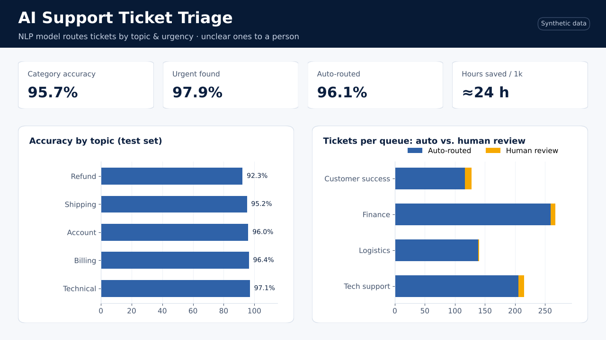

# AI Support Ticket Triage

**Business question:** a support team reads every ticket by hand before it reaches the right person.
Can a model sort tickets by topic and urgency automatically, and send only the unclear ones to a person?

> All tickets are **synthetic** (generated by `src/generate_tickets.py`). The numbers below show how the
> method performs on this sample data, not results from a real company.



## Result (test set, 750 tickets)

| Metric | Value |
|---|---|
| Category accuracy | **95.7 %** (baseline "always the most common topic": 26 %) |
| Urgent tickets found (High recall) | **97.9 %** |
| Tickets routed automatically | **96.1 %**; the rest (3.9 %) go to human review |
| Accuracy on auto-routed tickets | **96.8 %** |
| Estimated time saved | **≈ 24 h per 1,000 tickets** (assumption: 1.5 min of manual sorting per ticket) |

### What's good / what's not / what to do

| What's good | What's not | What to do |
|---|---|---|
| Topic and urgency are found for almost every ticket in under a second | About 4 % of the labels are wrong on purpose (real helpdesk data is noisy), which caps accuracy | Start in "suggest" mode: agents confirm the label, and their corrections become new training data |
| Unclear tickets are not guessed: they go to a person | Urgency relies on clear words ("urgent", "blocked"); polite urgent tickets can be missed | Add an LLM check (`src/llm_triage.py`) for tickets marked Normal that mention money or blocked work |

## How it works

```
ticket text ─► TF-IDF (words + character n-grams) ─► logistic regression ─► category + urgency + confidence
                                                                         │
                         confidence ≥ 0.60 ─► queue (Finance, Tech, …) + SLA (4 h / 24 h / 72 h)
                         confidence < 0.60 ─► human review
```

* `src/generate_tickets.py` creates 3,000 tickets in 5 topics with typos, mixed topics and 4 % wrong labels.
* `src/triage.py` trains the two models, evaluates them on a held-out 25 %, routes each ticket and writes
  `reports/metrics.json`, `reports/results.md`, the confusion matrix and `reports/triaged_test_tickets.csv`.
* `src/llm_triage.py` (optional) sends a sample to an LLM with the prompt in `prompts/triage_prompt.md`,
  checks the JSON answer against the allowed labels and compares it with the classic model.
  It works with any OpenAI-compatible LLM API (hosted or local) and needs your own `LLM_API_KEY` and `LLM_MODEL`; the rest of the project runs without it.
* `tests/` checks the data, the routing rules and the LLM answer parser; GitHub Actions runs them on every push.

Why a classic model first? It is fast, cheap, explainable and runs offline. An LLM is used as a second
opinion where it adds the most value, not for every ticket.

## Run it

```bash
pip install -r requirements.txt
python src/generate_tickets.py
python src/triage.py
pytest -q
```

## Limitations

* Synthetic, template-based texts are easier than real tickets; expect lower accuracy on real data.
* Urgency is learned from wording only; real triage should also use customer tier and ticket history.
* The time-saving figure is an estimate based on an assumed 1.5 minutes per ticket.

## Tools

Python · pandas · scikit-learn · matplotlib · pytest · GitHub Actions · optional LLM API (any OpenAI-compatible provider)
