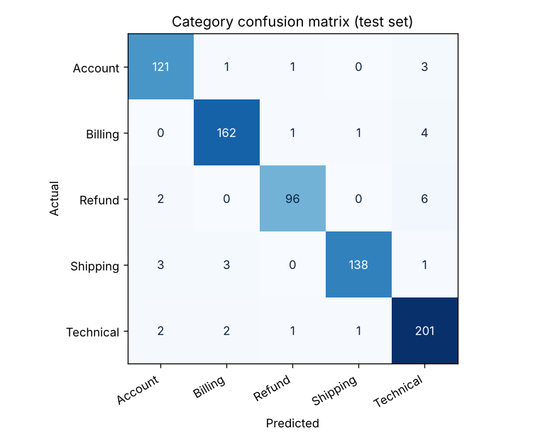

# Results

Synthetic data. Figures show how the method works, not results from a real company.

| Metric | Value |
|---|---|
| tickets_total | 3000 |
| tickets_test | 750 |
| category_accuracy | 0.957 |
| category_macro_f1 | 0.957 |
| urgency_accuracy | 0.995 |
| high_urgency_recall | 0.979 |
| auto_routed_share | 0.961 |
| auto_routed_category_accuracy | 0.968 |
| review_threshold | 0.6 |
| est_hours_saved_per_1000_tickets | 24.0 |

## Category report (test set)

```
              precision    recall  f1-score   support

     Account      0.945     0.960     0.953       126
     Billing      0.964     0.964     0.964       168
      Refund      0.970     0.923     0.946       104
    Shipping      0.986     0.952     0.968       145
   Technical      0.935     0.971     0.953       207

    accuracy                          0.957       750
   macro avg      0.960     0.954     0.957       750
weighted avg      0.958     0.957     0.957       750

```

